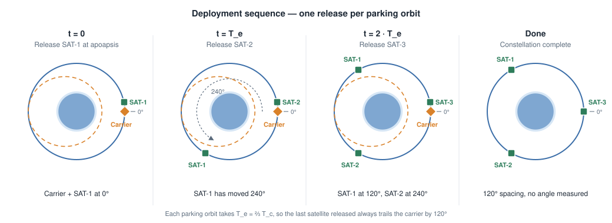

# Relay Orbiter

**Deploy a relay constellation with one launch and one button.**
Relay Orbiter is a Kerbal Space Program 1.12 mod that takes a carrier vessel holding
2 to 12 relay satellites and puts them on a shared circular orbit, evenly spaced
(360°/N apart): it reaches the orbit you choose, releases one satellite per parking
orbit, switches to each one, circularizes it and comes back to the carrier. From the
launch pad, it can hand the ascent to MechJeb first.

[](https://alanlrde.github.io/KSP_RelayOrbiter_mod/)

Full documentation: **<https://alanlrde.github.io/KSP_RelayOrbiter_mod/>**

<p align="center"></p>

## Features

- **Any constellation size:** 2 to 12 satellites, 360°/N apart.
- **Target orbit of your choice:** synchronous orbit, the orbital altitude of a moon,
  the midpoint between two moons (or planets, around the Sun), or any altitude.
- **Optional inclination:** launch to it, or change the plane in orbit.
- **Full automation:** Hohmann transfer to the target, plane change, release of every
  satellite, vessel switching and circularization burns, with time warp handled.
- **Launch from the pad with MechJeb** (optional): MechJeb flies the ascent, Relay
  Orbiter takes over in orbit.
- **Safe by design:** checks the plan before starting (satellites, SAS, engines,
  fuel and delta-v of the carrier alone, safe periapsis, SOI), never stages away a
  satellite, tops up the satellites' tanks before each release, orients the carrier
  so the release push doesn't change the satellite's period, and waits until the
  satellite is clear before it turns.
- **Unique names:** satellites are renamed `Kerbin Orion 2/6 - SYNC i10` and marked
  as relays.
- **CommNet check:** warns when the satellites won't see or reach each other.
- **Resume:** a deployment interrupted by a scene reload (or a quickload) can be resumed.
- **RCS separation:** with RCS, the carrier pushes itself away from each released satellite.
- **Works with planet packs:** bodies come from the running game (stock, Kopernicus,
  Outer Planets Mod...).
- **Manual mode too:** a Maneuvers tab creates the nodes and Alarm Clock alarms if you
  prefer to fly it yourself.

## Requirements

| | |
|---|---|
| KSP | 1.12.x (tested on 1.12.5) |
| Optional | [MechJeb 2](https://github.com/MuMech/MechJeb2) (2.15) to launch from the ground |

## Installation

1. Download `RelayOrbiter-<version>.zip` from the
   [releases](https://github.com/AlaNLrdE/KSP_RelayOrbiter_mod/releases) (or build it, see below).
2. Copy the `RelayOrbiter` folder into your KSP `GameData` folder, so you have
   `GameData/RelayOrbiter/Plugins/RelayOrbiter.dll` and `RelayOrbiter.Core.dll`.
3. Start KSP. The Relay Orbiter button (a planet with three satellites) appears in
   the toolbar in flight and in map view.

To uninstall, delete `GameData/RelayOrbiter`.

## Quick start

1. **Build the carrier.** Hang each satellite on a decoupler or a Clamp-O-Tron
   docking port, and give every satellite a probe core with SAS, an engine with fuel
   and an antenna. Put the satellites' separators in the **last** stages, after the
   carrier's own engine. See [Vessel design](https://alanlrde.github.io/KSP_RelayOrbiter_mod/vessel_design.html).
2. **Open the window** in flight and set **Satellites** (2 to 12).
3. **Choose the target altitude:** *Synchronous*, *At a moon*, *Midpoint* or *Custom*.
4. **Go to the Automation tab** and click the satellites in release order (#1, #2, ...).
   Optionally tick **Change inclination to** and enter the inclination.
5. **Read the plan,** then press **Start deployment** (in orbit) or
   **Launch with MechJeb** (on the pad). Don't touch the controls or switch vessels
   until it says *Constellation deployed*.

## How it works

The carrier releases SAT-1 on the circular target orbit, then lowers its periapsis
so its orbit takes **(N−1)/N** of the satellites' period. Each parking orbit it comes
back to the release point 1/N of an orbit behind the satellites released before, and
releases the next one, which circularizes there. After N−1 parking orbits the N
satellites are 360°/N apart.

<p align="center"></p>

When that inner parking orbit's periapsis would be underground or in the atmosphere
(low orbits, or N = 2), the carrier raises its apoapsis instead: an **outer** parking
orbit of period (N+1)/N, with the satellites released at periapsis.

<p align="center"></p>

The whole sequence, as Automation runs it:


The math, every safety check and each automation step are explained in
[How it works](https://alanlrde.github.io/KSP_RelayOrbiter_mod/how_it_works.html) and
the [Automation reference](https://alanlrde.github.io/KSP_RelayOrbiter_mod/automation.html).

## Building from source

Needs the [.NET SDK](https://dotnet.microsoft.com/download) 8 or later and a KSP 1.12
install to compile against.

```bash
cp KspPaths.props.example KspPaths.props     # then set KSPDir to your KSP folder
dotnet build                                 # builds and stages GameData/RelayOrbiter
dotnet test                                  # core unit tests
./deploy.sh                                  # finds the Steam install, builds Release, copies the mod
```

`dotnet build src/RelayOrbiter.Plugin -p:DeployToKsp=true` copies the mod into the
install set in `KspPaths.props` instead.

| Path | Contents |
|---|---|
| `src/RelayOrbiter.Core/` | Orbital math and planning, no KSP or Unity references (`netstandard2.0` + `net472`) |
| `src/RelayOrbiter.Plugin/` | The KSP plugin: window, panels, deployment runner, node executor (`net472`) |
| `tests/RelayOrbiter.Core.Tests/` | xUnit tests of the core, including golden vectors from the C++ calculator |
| `docs/` | This documentation (Sphinx) |
| `GameData/RelayOrbiter/` | The mod folder that gets installed (DLLs staged by the build) |

The orbital math is checked against golden vectors exported by
[KSP_RelayOrbiter_calculator](https://github.com/AlaNLrdE/KSP_RelayOrbiter_calculator),
the C++ command-line calculator this mod is based on. See
[Development](https://alanlrde.github.io/KSP_RelayOrbiter_mod/development.html).

## Troubleshooting

Every step and every problem is written to `KSP.log` with the `[RelayOrbiter]` prefix.
The [Troubleshooting](https://alanlrde.github.io/KSP_RelayOrbiter_mod/troubleshooting.html)
page lists the messages, what causes them and how to fix them.

## License

[MIT](LICENSE). Kerbal Space Program and its assemblies are not included and are not
covered by this license.
